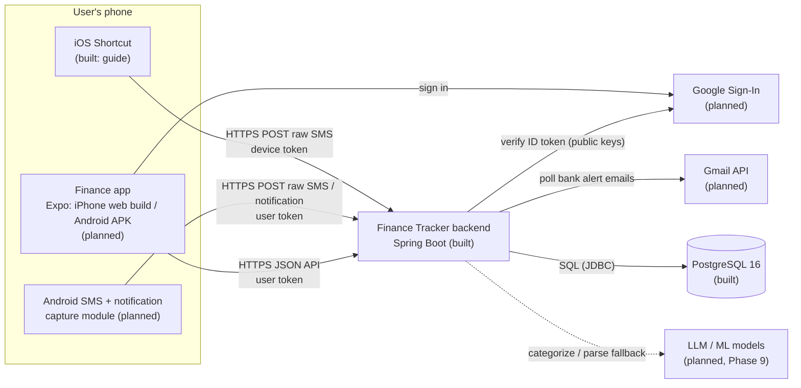
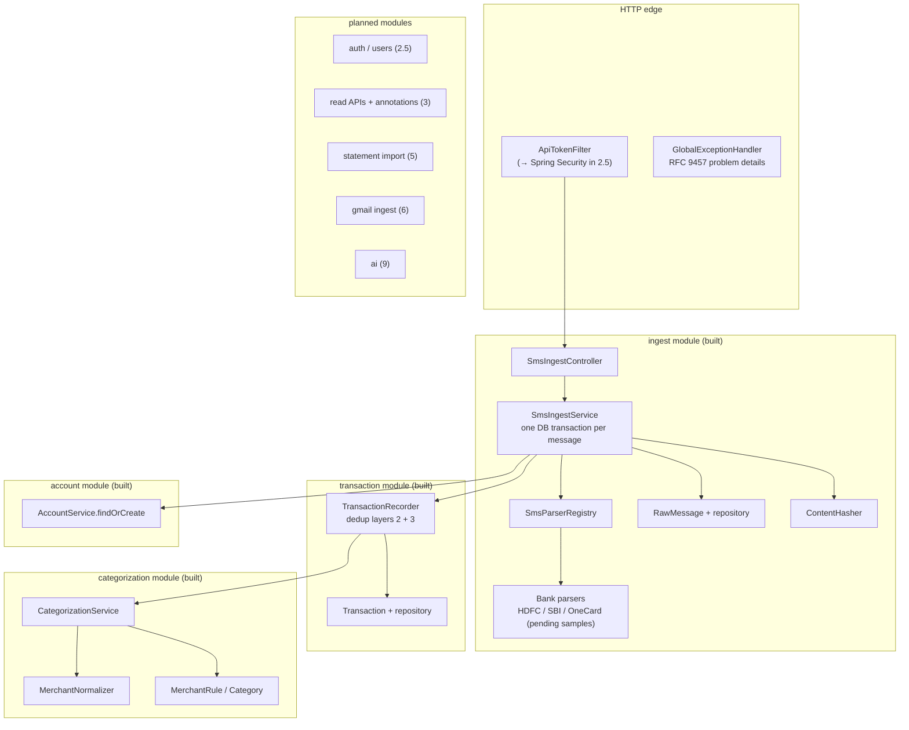
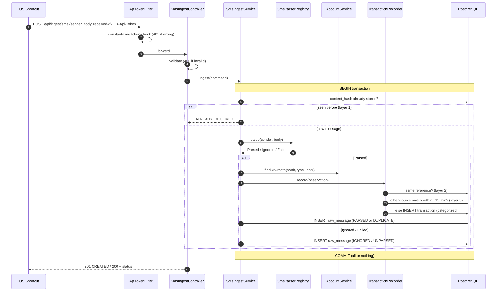
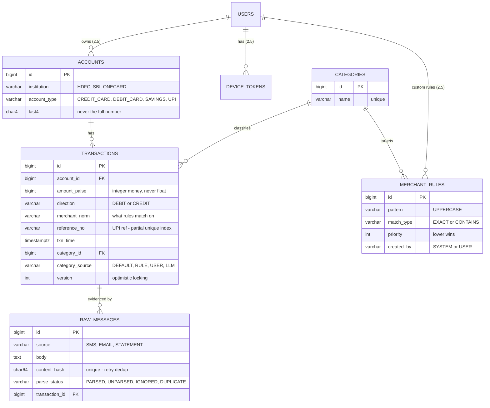
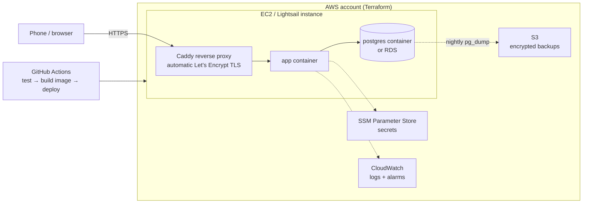

# Architecture

> **Note (2026-11-18):** the backend is moving from Java/Spring Boot to Node/TypeScript/Fastify ([ADR-0009](decisions/0009-node-typescript-fastify.md)). The architecture (modules, flow, data model, dedup) stays the same; class names in the diagrams refer to the Java version and will be updated when the port is merged. The deployment target is now free-tier ([ADR-0010](decisions/0010-free-hosting.md)): Oracle VM + Caddy + DuckDNS, later k3s.

The diagrams use [Mermaid](https://mermaid.js.org/), which GitHub renders automatically. Every element is marked **(built)** or **(planned)**.

## 1. Style: a modular monolith

**One deployable backend service, internally split into modules with clear boundaries.**

Why not microservices?
- The cost of microservices is operational: many deployments, network calls between services, distributed transactions, and tracing across services.
- That cost pays off when *many teams* need to deploy independently. We have one developer and roughly 10 transactions a day.
- A well-modularized monolith can be split later along the module seams if a real need appears. Splitting a tangled monolith is far harder.

This is the default recommendation in industry for new products ("monolith first"). See [ADR-0006](decisions/0006-package-by-feature.md).

## 2. System context: who talks to the system

**Key principle, the thin client ([ADR-0003](decisions/0003-thin-client-server-side-parsing.md)):** phones only *forward raw text*. All parsing, dedup and categorization happen on the server. When a bank changes its SMS format, we fix one parser on the server and every user benefits immediately, with no app update.

## 3. Inside the backend: modules and layers

**Layering inside each module:** Controller (HTTP only) → Service (business rules, transaction boundary) → Repository (persistence only) → Domain (entities, value objects). Dependencies only point inward and downward.

**Module dependency direction:** `ingest → transaction → categorization`, and `ingest → account`. Lower modules never import upper ones. For example, `transaction` uses native SQL rather than importing `ingest.RawMessage`, which keeps the dependency graph acyclic.

## 4. One SMS, end to end

**Guarantees:**
- **No message is ever lost.** Even a parser crash results in a stored `UNPARSED` row.
- **Retries are safe** (idempotency).
- **Writes are atomic:** the account, the transaction and the raw message commit together or not at all.

## 5. Data model

**The pattern: a golden record plus an evidence log.**
- `raw_messages` is the immutable evidence: every message that arrived.
- `transactions` is the derived golden record: one row per real-world payment, however many messages reported it.

This is the same idea as event logs and ETL pipelines: keep the raw input, so derived data can always be rebuilt. See [ADR-0004](decisions/0004-raw-message-evidence-log.md).

**Integrity lives in the database, not only in code.**
- CHECK constraints: 4-digit `last4`, positive amounts, valid enumerations.
- Unique indexes: the dedup layers.
- Foreign keys.

Application bugs come and go; constraints hold. See [ADR-0002](decisions/0002-postgresql.md) and [ADR-0005](decisions/0005-three-layer-deduplication.md).

**Planned additions:**
- **Phase 2.5:** `users`, `device_tokens`, `refresh_tokens`, and `user_id` on every owned table.
- **Phase 3:** notes, tags, `payees` (by UPI ID), `transaction_splits`.
- **Phase 5:** statement tables.

## 6. Security architecture

| Concern | Built | Planned |
|---|---|---|
| Who is calling? | Static ingest token (single user) | Google sign-in → our own short-lived JWT + rotating refresh token; per-device tokens for Shortcuts (2.5) |
| Can they see this row? | n/a (single user) | Every query scoped by `user_id` (2.5) + Postgres Row-Level Security (before friends join) |
| Secrets | Env vars only; `.env` git-ignored | AWS SSM Parameter Store / Secrets Manager (7) |
| Sensitive data | Last-4 only (DB-enforced), OTPs redacted, SMS bodies never logged | Encryption at rest (RDS/EBS), encrypted backups (7) |
| Transport | localhost only | HTTPS everywhere (7) |
| Timing attacks | Constant-time token comparison | Same for device tokens (hashed with SHA-256) |

## 7. Deployment

**Today:** Docker Compose on a laptop: one `app` container plus one `postgres` container, bound to localhost.

**Target (Phase 7)**, the simplest production-grade setup for this scale:

Kubernetes is deliberately **not** in this path. One small service doesn't need an orchestrator. Kubernetes is learned better on a project that needs it, or later as an explicit learning exercise (for example k3s with the same image). That is an honest trade-off between learning goals and operational cost.

## 8. Cross-cutting concerns

| Concern | Approach |
|---|---|
| Configuration | 12-factor: everything from env vars; the same image runs everywhere |
| Schema changes | Flyway, append-only versioned migrations; Hibernate only *validates* |
| Time | Stored as UTC `TIMESTAMPTZ`; "this month" computed in `Asia/Kolkata`; `Clock` injected for testability |
| Money | `BIGINT` paise; `BigDecimal` when parsing text |
| Errors | RFC 9457 problem details; 409 on constraint races |
| Testing | Unit tests for pure logic; integration tests against real Postgres via Testcontainers; one shared Spring context |
| Observability (8) | Structured JSON logs, Micrometer metrics, "no transaction in 3 days" alert |
